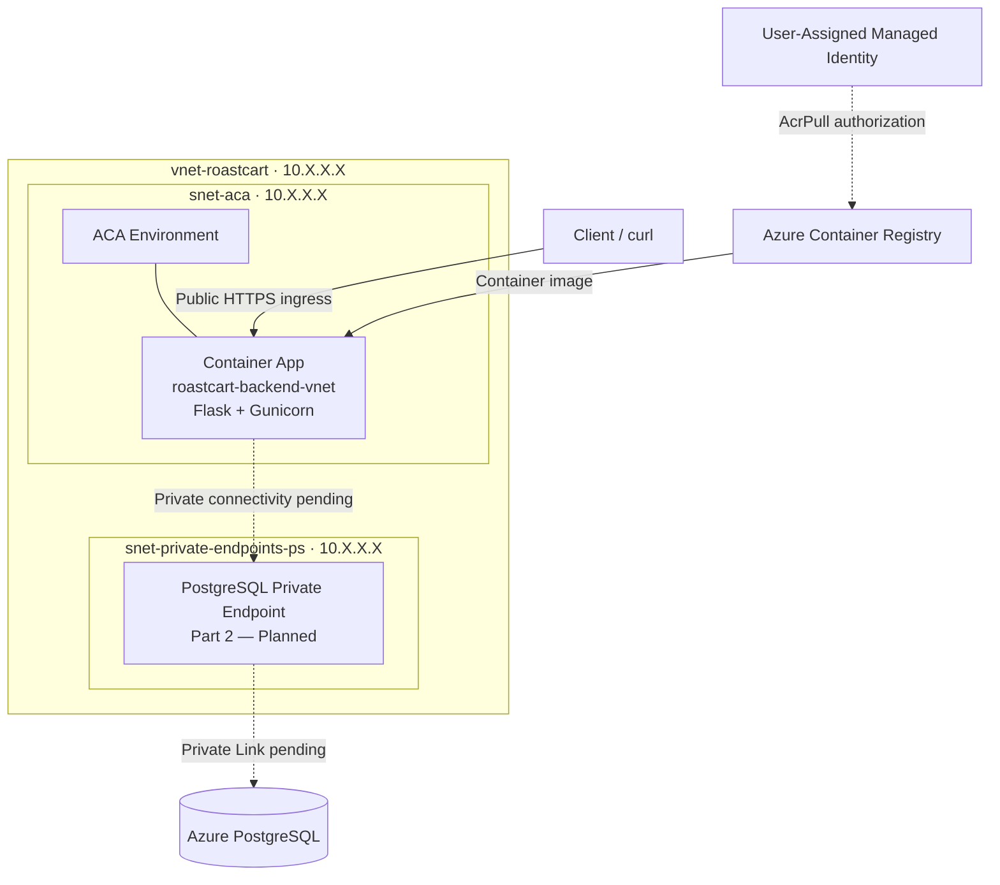
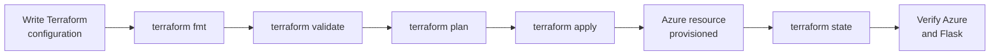

# RoastCart — Terraform Private Connectivity

## Part 1: Deploying Flask Backend to VNet-Integrated Azure Container Apps

**Branch:** `feature/terraform-private-link`  
**Status:** ✅ Part 1 Completed | Part 2 Pending  
**Infrastructure:** Microsoft Azure · Terraform · Azure Container Apps

### 1. Overview

This milestone demonstrates the deployment of RoastCart's Flask backend to an existing VNet-integrated Azure Container Apps (ACA) environment using Terraform.

Building upon the previous `feature/terraform-network` milestone, where the VNet and subnets were imported into Terraform state, this stage introduces **provisioning new Azure resources through Infrastructure as Code (IaC)**.

**Objectives achieved:**

- Provisioned a new backend Container App using Terraform.
- Reused existing Azure resources through Terraform data sources.
- Configured ACR image pulls using a user-assigned managed identity.
- Configured application secrets, HTTPS ingress, and container resources.
- Verified the Flask backend through its health endpoint.
- Enabled scale-to-zero to minimize idle compute costs.

**Scope:** PostgreSQL private connectivity is not yet implemented. It will be covered in Part 2.

---

### 2. Architecture



The backend is deployed within an ACA environment integrated with `snet-aca`. The PostgreSQL Private Endpoint and Private DNS configuration are reserved for Part 2.

### 3. Terraform Resources and Azure Service Mapping

| Terraform declaration                                           | Azure service            | Purpose                                               |
| --------------------------------------------------------------- | ------------------------ | ----------------------------------------------------- |
| `azurerm_container_app.backend_vnet`                            | Azure Container Apps     | Creates and manages the new Flask backend             |
| `data.azurerm_container_app_environment.roastcart_aca_env_vnet` | ACA Environment          | References the existing VNet-integrated environment   |
| `data.azurerm_container_registry.roastcart`                     | Azure Container Registry | Retrieves the existing registry login server          |
| `data.azurerm_user_assigned_identity.acr_pull`                  | Managed Identity         | References existing identity for image pulls          |
| `data.azurerm_resource_group.roastcart`                         | Azure Resource Group     | References the existing resource group                |
| `azurerm_virtual_network.roastcart`                             | Virtual Network          | Existing Terraform-managed VNet                       |
| `azurerm_subnet.aca`                                            | VNet Subnet              | Existing ACA infrastructure subnet                    |
| `azurerm_subnet.private_endpoints`                              | VNet Subnet              | Existing subnet reserved for future Private Endpoints |

**Key distinction:**

- `data` reads existing Azure infrastructure without managing its lifecycle.
- `resource` declares infrastructure managed by Terraform, including resources created through `terraform apply`.

### 4. Container App Configuration

The new ACA Backend is configured with:

| Setting             | Configuration                               |
| ------------------- | ------------------------------------------- |
| Container image     | `<ACR_NAME>/roastcart-backend:<commit-sha>` |
| Managed identity    | `roastcart-aca-pull-identity`               |
| Registry permission | `AcrPull`                                   |
| CPU / Memory        | 0.5 vCPU / 1 GiB                            |
| Workload profile    | Consumption                                 |
| HTTP ingress        | External HTTPS, targeting port 5000         |
| Revision mode       | Single                                      |
| Replica range       | 0–1                                         |
| Application secret  | `database-url` referenced by `DATABASE_URL` |

Sensitive database credentials are supplied through a Git-ignored `terraform.tfvars` and injected into ACA as an application secret. This approach keeps credentials out of committed Terraform configuration, although secret values remain sensitive within local Terraform state.

### 5. Terraform Workflow



The deployment was completed with:

```text
Apply complete! Resources: 1 added, 0 changed, 0 destroyed.
```

The new resource is now tracked as:

```text
azurerm_container_app.backend_vnet
```

Following configuration reconciliation and the scaling update:

```text
No changes. Your infrastructure matches the configuration.
```

### 6. Verification Results

**Azure deployment**

- Container App provisioning state: `Succeeded`
- Backend ACA is now deployed in the correct ACA environment
- Container revision successfully created
- Terraform resource successfully recorded in state

**Application health**

```bash
curl -i "https://<ACA-FQDN>/api/v1/health"
```

Result:

```http
HTTP/2 200
```

```json
{
  "service": "roastcart-backend",
  "status": "All good"
}
```

This confirms successful container startup and Flask/Gunicorn HTTP availability, but does not verify database connectivity.

**Scale-to-zero**

```hcl
min_replicas = 0
max_replicas = 1
```

After an idle period, no active replicas were listed, consistent with the configured scale-to-zero behavior.

### 7. Key Learning Outcomes

1. **Infrastructure provisioning:** Terraform can create Azure resources using declarative HCL configuration.
2. **Resource dependencies:** Terraform references existing Azure resources through data sources and resource attributes instead of hardcoded IDs.
3. **Managed identities:** ACA can authenticate to ACR without storing registry passwords in application configuration.
4. **Application secrets:** Sensitive configuration is injected into the container through ACA secret references.
5. **Terraform state:** Terraform tracks created resources and detects differences between configuration and deployed infrastructure.
6. **Idempotency:** A no-change plan indicates that tracked infrastructure matches the desired configuration.
7. **Cost optimization:** ACA Consumption workloads can scale to zero when idle, reducing compute usage.

### 8. Part 2 — PostgreSQL Private Connectivity

The next stage will establish private communication between deployed backend ACA and Azure PostgreSQL Flexible Server.

**Target result:** Flask connects to PostgreSQL using its existing database hostname, resolved through Private DNS to a Private Endpoint IP within `snet-private-endpoints`, while PostgreSQL public network access remains disabled.

---

**Milestone status:** Part 1 completed — Terraform-provisioned Flask backend running successfully in the VNet-integrated ACA environment. Private database connectivity remains pending.
