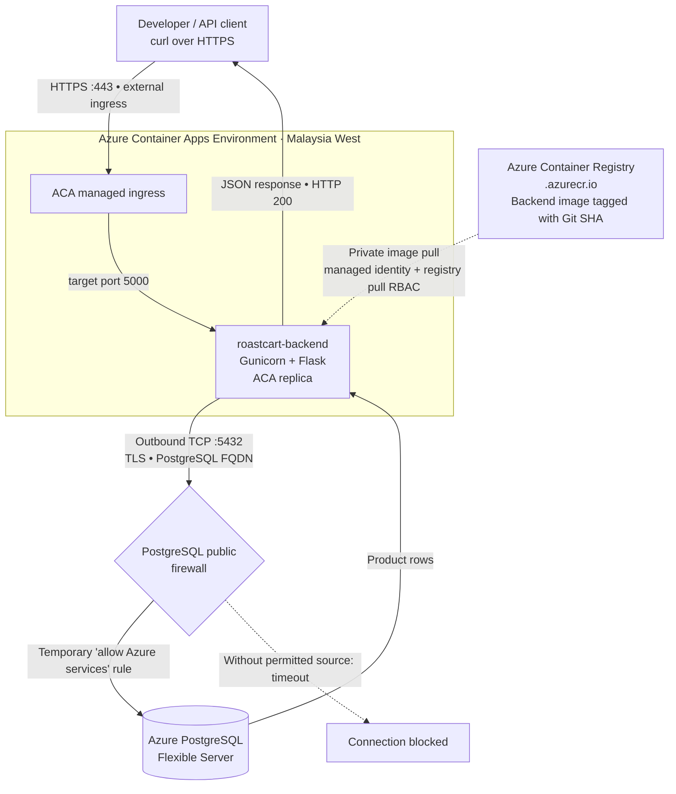

# Milestone — Flask Backend on Azure Container Apps ↔ Azure PostgreSQL

**Project:** RoastCart (Cloud & DevOps portfolio)  
**Milestone:** First functional Azure-hosted backend/database integration  
**Status:** ✅ Functional validation complete · ⚠️ Network hardening outstanding  
**Scope:** Infrastructure configuration and verification only — **no application source-code changes**  
**Suggested feature branch:** `feature/aca-backend-postgres`

## Objective

Deploy the existing production Flask/Gunicorn backend image from Azure Container Registry (ACR) into Azure Container Apps (ACA), connect it to Azure Database for PostgreSQL Flexible Server, and demonstrate that an external HTTPS request retrieves actual coffee product records from the managed database.

This milestone intentionally establishes _functional connectivity_ first. The database firewall's broad Azure-services exception is a **temporary test workaround**, **not a recommended production networking design**.

## Architecture and connection boundaries



**Boundary clarification:** External ACA ingress governs **incoming API traffic**. The database firewall governs **outbound ACA traffic reaching PostgreSQL**. Allowlisting a developer Mac's IP does _not_ allow the ACA backend's outbound connections. ACA's public HTTPS address is not its database egress IP.

## Existing components reused

| Component                                                  | Role                                                                              |
| ---------------------------------------------------------- | --------------------------------------------------------------------------------- |
| `<ACA_ENV_BOUNDARY_BOX>`                                   | ACA runtime environment                                                           |
| `roastcart-backend`                                        | Flask API Container App; external ingress for testing, target port `5000`         |
| `<ACR_NAME>.azurecr.io/roastcart-backend:<git-sha>`        | Prebuilt production container artifact from CI/CD                                 |
| User-assigned managed identity + appropriate ACR pull role | Image pull authorization without a registry password in application configuration |
| Azure PostgreSQL Flexible Server (`<AZURE_DB>`)            | Managed product database, public-access networking for this milestone             |
| ACA secret `database-url`                                  | Database connection string injected as environment variable `DATABASE_URL`        |

## Implementation and verification sequence

1. **Provisioned ACA Environment** (`<ACA_ENV_BOUNDARY_BOX>`) using Azure CLI, selecting an allowed deployment region (`malaysiawest`). The resource group's metadata location was `southeastasia`; specifying a permitted resource `--location` mattered for a user-assigned managed identity.
2. **Verified image in ACR.** Used the Git commit SHA from the ACR tag **Name** column, not the `sha256:` manifest digest, as the backend image tag. Image was already produced by the prior CI/CD milestone.
3. **Created user-assigned managed identity and assigned registry pull permissions.** Verified ACR's `authentication-as-arm` setting was enabled for the ACA managed-identity image-pull workflow.
4. **Created backend ACA with external HTTP ingress.** ACA handles HTTPS traffic on the public endpoint and routes to the container's Gunicorn listener on `0.0.0.0:5000`.
5. **Configured runtime database credentials.** Stored the Azure PostgreSQL SQLAlchemy URL in the ACA secret `database-url`; configured `DATABASE_URL=secretref:database-url`. The Flask configuration maps `DATABASE_URL` to `SQLALCHEMY_DATABASE_URI`. The URL used the Azure PostgreSQL hostname and `sslmode=require`.
6. **Resolved application startup issues.** The initial revision was unhealthy and reported `CrashLoopBackOff`; Gunicorn workers failed because Flask-SQLAlchemy had not received a usable database URI. Confirmed the production image's actual file layout (`/app/config.py`, `/app/app/__init__.py`), and tested its configuration and Flask initialization with a dummy URL locally. After resuming the ACA revision, the service was healthy and its DB-independent health endpoint returned HTTP 200.
7. **Diagnosed initial database request failure.** Calling `/api/v1/products` initially produced HTTP 502. Portal Console Log Stream showed `WORKER TIMEOUT` while SQLAlchemy/psycopg waited to connect, pointing to database connection reachability rather than a SQL query error.
8. **Temporarily allowed Azure-originated access in the PostgreSQL firewall.** Before this, the database firewall allowed the developer's public IP but not necessarily ACA egress. Enabling **“Allow public access from any Azure service within Azure to this server”** temporarily removed that blocker.
9. **Validated end-to-end functionality.** `GET /api/v1/health` returned HTTP 200; `GET /api/v1/products` returned **HTTP/2 200 with coffee products from Azure PostgreSQL** after the temporary firewall change.

## Verification commands

Replace placeholders with the actual values; commands are included as an operational record, not a deployment script.

```bash
# ACA application / revision inspection
az containerapp revision list \
  --name roastcart-backend --resource-group "$RG" --all \
  --query '[].{Name:name,Active:properties.active,Health:properties.healthState,Running:properties.runningState}' \
  --output table

# Public API startup check (does not prove DB connectivity)
curl -i "https://<backend-fqdn>/api/v1/health"

# End-to-end database integration check
curl -i "https://<backend-fqdn>/api/v1/products"
```

**Acceptance criteria and evidence**

| Check                                              | Observed outcome                                                |
| -------------------------------------------------- | --------------------------------------------------------------- |
| ACA backend revision                               | Running and healthy after troubleshooting                       |
| `/api/v1/health`                                   | HTTP 200, `{"service":"roastcart-backend","status":"All good"}` |
| `/api/v1/products` before Azure-services exception | HTTP 502; Gunicorn worker timeout during psycopg connection     |
| `/api/v1/products` after temporary exception       | HTTP/2 200, coffee product JSON returned                        |
| Production network isolation                       | **Not completed**                                               |

## Security note — known limitation

> **Temporary workaround only.** PostgreSQL's **“Allow public access from any Azure service within Azure to this server”** rule admits _connection attempts_ from Azure-hosted resources beyond this subscription; it is **not restricted to RoastCart's backend ACA**. It does not bypass PostgreSQL authentication, but it broadens the allowed network origin. Do **not** describe this setup as production-ready.

The current setup still uses database authentication, an ACA secret for credentials, and encrypted PostgreSQL transport via `sslmode=require`. `require` does not provide the same server-hostname verification as `verify-full`; certificate verification is a separate hardening item.

**After the functional demonstration:** Disable the broad Azure-services exception when not actively testing. Stopping the database when idle avoids compute costs but does not eliminate storage charges. Zero ACA replicas avoid replica consumption charges on the Consumption plan; registry and log-related costs may remain.

## Next milestone — Least-privilege networking and frontend ingress

1. Inspect whether the current ACA Environment uses Azure-managed networking or a customer-managed VNet; confirm workload profile and Azure Student cost constraints.
2. Design a minimal private connection path: VNet-integrated ACA Environment → Private Endpoint / private DNS → PostgreSQL, with public database access disabled **after** private connectivity succeeds. A replacement ACA Environment may be necessary if the existing environment cannot be migrated into a customer-managed VNet.
3. Deploy production React/Vite static assets using the Nginx image in a **frontend ACA with external ingress**.
4. Change the Flask backend to **internal ingress** after validating frontend-to-backend service discovery and Nginx reverse proxying.
5. Perform positive and negative access tests; document boundaries and translate the manual setup into Terraform later.

**Milestone claim:** _RoastCart's Flask backend was deployed from ACR to ACA and successfully queried Azure PostgreSQL over an HTTPS API request. Connectivity was demonstrated using a temporary permissive Azure-services database firewall exception; production-oriented network isolation is the next milestone._
