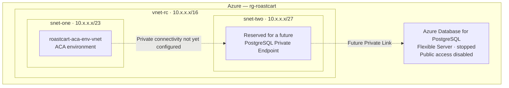
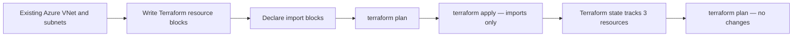

# RoastCart — Terraform Network Foundation

> **Milestone:** Adopt existing Azure networking into Terraform  
> **Branch:** `feature/terraform-network`  
> **Status:** Completed — imported and verified with a no-change plan

## Overview

RoastCart is a containerized three-tier demo application built to practice cloud infrastructure and DevOps workflows on Microsoft Azure. This milestone introduces **Infrastructure as Code (IaC)** with Terraform by adopting existing Azure networking resources **without recreating them**.

The goal is to establish a reliable, version-controlled network foundation before provisioning PostgreSQL private connectivity.

## Architecture at this milestone



**Current boundary:** The VNet and both subnets are Terraform-managed. The ACA environment and PostgreSQL server already exist in Azure but are **not** Terraform-managed in this milestone. The Private Endpoint and Private DNS zone have **not** been created.

### Terraform adoption workflow



## Resources managed by Terraform

| Azure resource | Terraform address                   | Purpose                                                                  |
| -------------- | ----------------------------------- | ------------------------------------------------------------------------ |
| `vnet-rc`      | `azurerm_virtual_network.roastcart` | Private networking foundation (`10.x.x.x/16`)                            |
| `snet-one`     | `azurerm_subnet.aca`                | Delegated subnet for the VNet-integrated ACA environment (`10.x.x.x/23`) |
| `snet-two`     | `azurerm_subnet.private_endpoints`  | Reserved subnet for Private Endpoints (`10.x.x.x/27`)                    |

The resource group, Azure Container Registry, and PostgreSQL Flexible Server are referenced through Terraform **data sources**. A data source reads an existing resource; it does not place that resource under Terraform lifecycle management.

## Terraform files

| File                       | Role                                            |
| -------------------------- | ----------------------------------------------- |
| `providers.tf`             | AzureRM provider configuration                  |
| `variables.tf`             | Input variable definitions                      |
| `terraform.tfvars.example` | Safe example of environment-specific values     |
| `data.tf`                  | Lookups for existing Azure resources            |
| `network.tf`               | VNet and subnet resource declarations           |
| `imports.tf`               | Import declarations for existing infrastructure |
| `.terraform.lock.hcl`      | Locked provider dependency versions             |

> Keep actual `terraform.tfvars`, Terraform state files, `.terraform/`, credentials, and sensitive plan outputs out of Git. Review resource IDs in import blocks before publishing.

## Verification

```bash
terraform fmt -check
terraform validate
terraform state list
terraform plan
```

**Confirmed outcome:**

```text
Apply complete! Resources: 1 imported, 0 added, 0 changed, 0 destroyed.

azurerm_virtual_network.roastcart
azurerm_subnet.aca
azurerm_subnet.private_endpoints

No changes. Your infrastructure matches the configuration.
```

The apply output above is from the **final subnet import**; the VNet and ACA subnet were imported in earlier steps. Across this adoption milestone, the imports did not create, change, or delete Azure resources.

## Key takeaways

- **Infrastructure as Code:** Define intended Azure infrastructure in version-controlled `.tf` files.
- **Import:** Bring existing Azure resources under Terraform management without recreating them.
- **State:** Terraform records which real Azure resources correspond to managed resource addresses.
- **Plan before apply:** Inspect proposed changes before altering infrastructure.
- **No-change plan:** Confirms that the currently managed resources match their declared configuration; it does **not** mean all Azure resources are Terraform-managed.

## Next milestone

1. Confirm the correct PostgreSQL Flexible Server identity and Private Link eligibility.
2. Provision a PostgreSQL **Private Endpoint** in `snet-two` using Terraform.
3. Configure a **Private DNS zone**, virtual network link, and private endpoint DNS integration.
4. Verify that the ACA backend can resolve and reach PostgreSQL privately while public database access remains disabled.
5. Review costs and safe resource lifecycle practices before applying paid infrastructure.

> **Safety:** Do not use `terraform destroy` as a pause switch for this shared network foundation. Other Azure resources depend on these subnets and may not yet be managed by Terraform.
