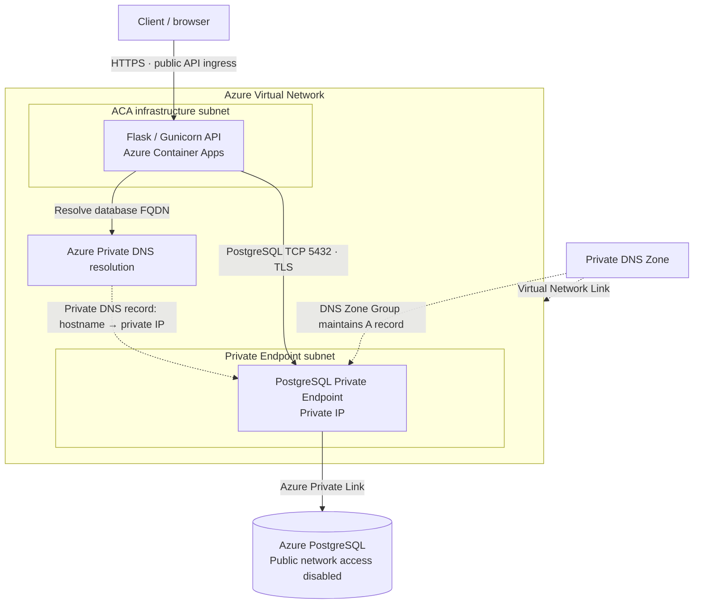

# RoastCart — Private PostgreSQL Connectivity Milestone

**Status:** Completed and verified ·
**Scope:** VNet-integrated Flask API → Azure Database for PostgreSQL Flexible Server via Azure Private Link  
**Next:** Deploy the React/Vite frontend and validate the complete application journey

## Outcome

Deployed a containerized Flask/Gunicorn backend to **Azure Container Apps (ACA)** in a VNet-integrated environment. Secured access to **Azure Database for PostgreSQL Flexible Server** using an **Azure Private Endpoint** and **Azure Private DNS** with public database network access disabled.

Validated connectivity from the running application container through DNS resolution, TCP port 5432, and a real database-backed API request.

## Architecture



> The diagram is conceptual. The browser-to-API path is public HTTPS; only the backend-to-database connection uses Private Link. The frontend is **not yet deployed to ACA** in this milestone.

## Private DNS — three components

| Component                  | Responsibility                                                                                       |
| -------------------------- | ---------------------------------------------------------------------------------------------------- |
| **Private DNS Zone**       | Stores hostname-to-private-IP DNS records.                                                           |
| **Virtual Network Link**   | Makes those private DNS records resolvable from the linked VNet using Azure DNS.                     |
| **Private DNS Zone Group** | Associates the Private Endpoint with the zone and automatically maintains the endpoint's DNS record. |

A DNS lookup does **not** grant database access; network reachability, TLS, and PostgreSQL authentication are separate concerns.

## Terraform design

Two Terraform root configurations separate long-lived infrastructure from disposable networking:

```text
terraform/
├── ...                           # Core infrastructure and VNet-integrated ACA
└── private-link/
    ├── data.tf                   # References existing infrastructure
    ├── private-endpoint.tf       # Private Endpoint + nested DNS Zone Group
    ├── private-dns.tf            # Private DNS Zone + VNet Link
    ├── providers.tf
    ├── variables.tf
    └── versions.tf
```

The `private-link` configuration manages:

- `azurerm_private_endpoint.postgres` (including `private_dns_zone_group`)
- `azurerm_private_dns_zone.postgres`
- `azurerm_private_dns_zone_virtual_network_link.roastcart`

The existing VNet, subnets, ACA hosting environment, and PostgreSQL server are referenced as **data sources**, not recreated by the disposable configuration.

## Verification evidence

| Check                      | Verified result                                                     |
| -------------------------- | ------------------------------------------------------------------- |
| ACA revision and replica   | Running, healthy, one replica                                       |
| Public health endpoint     | `HTTP 200`                                                          |
| Database network access    | Public access disabled                                              |
| Private Endpoint           | Provisioning succeeded; connection approved                         |
| DNS record                 | PostgreSQL Private Link A record matches endpoint NIC private IP    |
| DNS inside Flask container | Database FQDN resolved to expected private IP                       |
| Network connectivity       | TCP connection to port `5432` succeeded                             |
| Application integration    | `GET /api/v1/products` returned `HTTP 200` and five coffee products |
| Terraform reconciliation   | `terraform plan` reported no changes                                |

## Operational practice

The isolated Terraform root allows Private Link networking to be recreated and destroyed for development sessions while preserving core infrastructure. **When pausing**, review `terraform plan -destroy`, destroy only the three managed Private Link resources **while PostgreSQL is running**, then stop PostgreSQL. Resume by starting PostgreSQL **before** applying the Private Link Terraform configuration. Verify DNS and endpoint status after recreation; the endpoint IP may change.

The stopped PostgreSQL server can automatically restart after seven days, and retained Azure resources may still accrue costs. Never commit Terraform state files, credentials, or secret-bearing variables.

## Next milestone

Deploy a production-built **React/Vite frontend** as an Azure Container App, configure its API base URL and CORS, and validate browser → frontend → backend → private PostgreSQL. Evaluate whether the API should remain publicly accessible or be exposed through a same-origin reverse-proxy/BFF pattern; a browser cannot call an ACA-internal-only hostname directly.

## References

- [Azure PostgreSQL Private Link networking](https://learn.microsoft.com/en-us/azure/postgresql/flexible-server/concepts-networking-private-link)
- [Azure Container Apps ingress](https://learn.microsoft.com/en-us/azure/container-apps/ingress)
- [Communication between Azure Container Apps](https://learn.microsoft.com/en-us/azure/container-apps/connect-apps)
